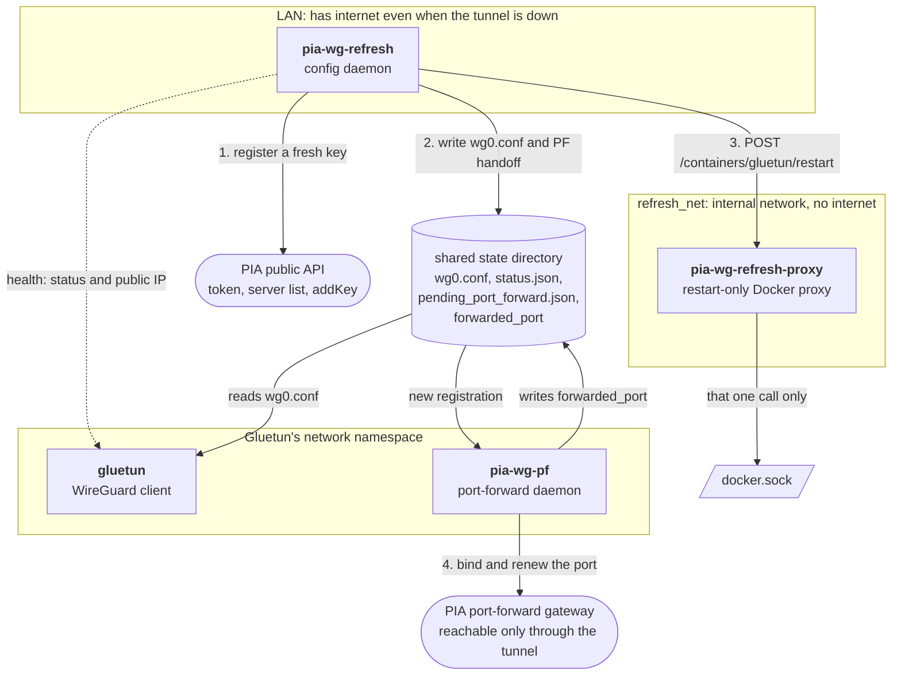
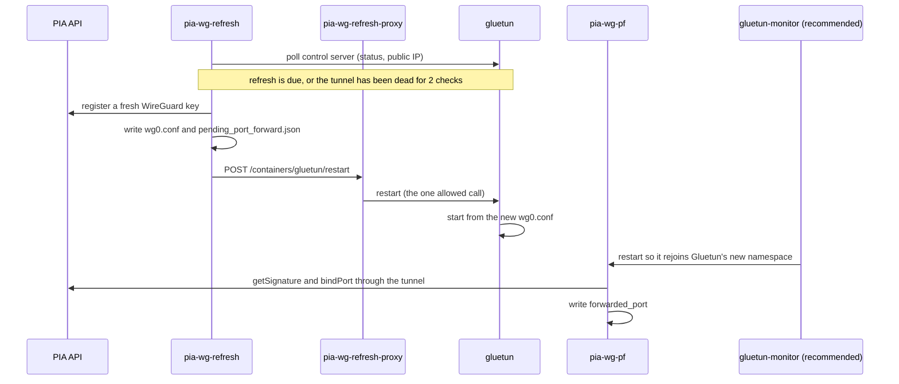

# PIA WireGuard Config Generator

<p align="center">
  <strong>Automation-friendly WireGuard config generation for Private Internet Access.</strong>
</p>

<p align="center">
  Built for Docker, Gluetun, routers, firewalls, homelabs, headless servers and long-running VPN gateways.
</p>

<p align="center">
  <a href="https://github.com/thecodingrasta/pia-wg-config-generator/actions"></a>
  <a href="https://github.com/thecodingrasta/pia-wg-config-generator/releases"></a>
  <a href="https://github.com/thecodingrasta/pia-wg-config-generator/blob/main/COPYING"></a>
  <a href="https://securityscorecards.dev/viewer/?uri=github.com/thecodingrasta/pia-wg-config-generator"></a>
  <a href="https://github.com/thecodingrasta/pia-wg-config-generator/pkgs/container/pia-wg-config-generator"></a>
  <a href="https://github.com/thecodingrasta/pia-wg-config-generator/issues"></a>
  <a href="https://github.com/thecodingrasta/pia-wg-config-generator/stargazers"></a>
</p>

---

<details>
<summary><strong>Table of contents</strong></summary>

* [What This Does](#what-this-does)
* [Why This Exists](#why-this-exists)
* [Features](#features)
* [Common Use Cases](#common-use-cases)
* [Quick Start](#quick-start)
  * [Before You Begin](#before-you-begin)
  * [1. Download the Binary](#1-download-the-binary)
  * [2. Make It Runnable](#2-make-it-runnable)
  * [3. Generate Your First Config](#3-generate-your-first-config)
  * [4. Use Your Config](#4-use-your-config)
* [Other Ways to Install](#other-ways-to-install)
* [Example: `wg-quick`](#example-wg-quick)
* [Commands](#commands)
* [IPv6 Modes](#ipv6-modes)
* [Docker / Gluetun](#docker--gluetun)
  * [How the Containers Fit Together](#how-the-containers-fit-together)
  * [What Each Container Does](#what-each-container-does)
  * [The Shared State Directory](#the-shared-state-directory)
  * [What Happens Over Time](#what-happens-over-time)
  * [Keeping `pia-wg-pf` Attached](#keeping-pia-wg-pf-attached)
  * [Set It Up](#set-it-up)
* [Routers and Firewalls](#routers-and-firewalls)
* [Windows Notes](#windows-notes)
* [Output Files](#output-files)
* [Security Notes](#security-notes)
* [Testing](#testing)
* [Architecture](#architecture)
* [Roadmap](#roadmap)
* [Contributing](#contributing)

</details>

---

## What This Does

Private Internet Access (PIA) doesn't provide permanent, static WireGuard configuration files through its user portal.
Instead, WireGuard connections are created through an authenticated API flow that dynamically provisions the session details needed to build a valid WireGuard configuration.

This tool automates that flow.

It can generate a standard `wg0.conf`, refresh it over time, maintain PIA port-forwarding leases, restart Gluetun when required, and write integration-friendly output files for downstream services.

In short:

> **PIA WireGuard, made practical for infrastructure-style setups.**

---

## Why This Exists

PIA WireGuard is not really a “download once and forget” workflow.

To establish a tunnel, a client needs to:

* authenticate with PIA,
* register a WireGuard public key,
* retrieve dynamic connection metadata,
* select a valid server and region,
* generate a WireGuard config,
* optionally bind a forwarded port,
* optionally renew that forwarded port over time.

That is awkward for:

* Docker stacks,
* Gluetun containers,
* Unraid boxes,
* OpenWrt routers,
* MikroTik routers,
* pfSense / OPNsense firewalls,
* headless Linux servers,
* long-running VPN gateway containers,
* P2P setups that depend on port forwarding.

`pia-wg-config-generator` bridges that gap by turning PIA WireGuard into something closer to a repeatable, refreshable and automation-friendly workflow.

---

## Features

* Generate standard WireGuard configs once and exit.
* Run as a long-running daemon for automatic refresh.
* Self-recover from provider-side WireGuard peer eviction - detect a dead tunnel and re-register automatically, from outside the tunnel.
* Split config refresh (on the LAN) from port-forward renewal (in-tunnel) so recovery works even when the tunnel is down.
* Renew rolling PIA port-forwarding leases.
* Write the active forwarded port to a file for downstream apps.
* Restart a Docker container after config refresh, useful for Gluetun.
* Run hooks after config refresh or forwarded-port changes.
* Select regions by ID, friendly name, or server common name.
* Filter to port-forwarding-capable regions.
* Support IPv6 dual-stack, IPv4-only, or IPv6 killswitch modes.
* Cache PIA tokens to avoid unnecessary authentication calls.
* Output to stdout or file.
* Work with Docker, Gluetun, routers, firewalls and headless systems.
* Ship as a single Go binary, and as a multi-architecture container image.

> [!IMPORTANT]
> PIA WireGuard sessions and port-forwarding leases can be ephemeral.
>
> This project is designed around refresh, automation and long-running infrastructure use cases.

---

## Common Use Cases

| Use case                                 | Supported |
| ---------------------------------------- | --------: |
| Generate a one-off `wg0.conf`            |       Yes |
| Use with `wg-quick`                      |       Yes |
| Use with Gluetun custom WireGuard mode   |       Yes |
| Run as a refresh daemon                  |       Yes |
| Maintain PIA port forwarding             |       Yes |
| Export active forwarded port to file     |       Yes |
| Restart Gluetun after config refresh     |       Yes |
| Use on headless Linux servers            |       Yes |
| Import config into routers/firewalls     |       Yes |
| Use without the official PIA desktop app |       Yes |

---

## Quick Start

New here? This is the path for you. You download one file, make it runnable, and generate a config. No Go toolchain, no compiler, no Docker required.

> [!TIP]
> If you are comfortable with Go or want a macOS build, skip to [Other Ways to Install](#other-ways-to-install).

### Before You Begin

You need:

* **A Private Internet Access account** — the same username and password you use to log into PIA. This tool logs into PIA's API on your behalf; it does not work without a paid PIA subscription.
* **Somewhere to use a WireGuard config** — the WireGuard app on your computer or phone, a router that supports WireGuard, or Docker/Gluetun. If you just want a VPN on your desktop, install the official [WireGuard app](https://www.wireguard.com/install/) first.

That's it. You do **not** need to install Go or build anything.

### 1. Download the Binary

Go to the [**Releases page**](https://github.com/thecodingrasta/pia-wg-config-generator/releases/latest) and download the file that matches your system:

| Your system                     | File to download          |
| ------------------------------- | ------------------------- |
| Linux (64-bit Intel/AMD)        | `pia-wg-config`           |
| Windows (64-bit Intel/AMD)      | `pia-wg-config.exe`       |
| Windows (ARM64)                 | `pia-wg-config-arm64.exe` |

> [!NOTE]
> **macOS and Linux ARM (Raspberry Pi, etc.)** don't have a prebuilt binary yet. The code is fully cross-platform, so the easiest path is [Install With Go](#install-with-go) below — it compiles a native binary for your machine in one command. macOS is a fully supported build target.

Most people want the "Assets" section of the **latest** release. Ignore the `Source code (zip / tar.gz)` links unless you specifically want to build from source.

### 2. Make It Runnable

**Linux**

Open a terminal in the folder where you downloaded the file, then mark it executable:

```bash
chmod +x ./pia-wg-config
```

You can now run it as `./pia-wg-config`. To run it from anywhere, move it onto your `PATH`:

```bash
sudo mv ./pia-wg-config /usr/local/bin/pia-wg-config
```

**Windows**

No extra step is needed — just open **PowerShell** in the folder where you downloaded the file and run `.\pia-wg-config.exe`. Windows may warn that the file is from the internet the first time; choose **Run anyway**.

Verify it works:

```bash
./pia-wg-config --version
./pia-wg-config --help
```

If you see the version and the list of commands, you're ready. (On Windows, use `.\pia-wg-config.exe --version`.)

### 3. Generate Your First Config

First, pick a region. List everything PIA offers with:

```bash
./pia-wg-config regions --username "YOUR_PIA_USERNAME" --password "YOUR_PIA_PASSWORD"
```

That prints region IDs like `uk_southampton`, `us_california`, `nl_amsterdam`. Pick one and generate a config:

```bash
./pia-wg-config generate \
  --username "YOUR_PIA_USERNAME" \
  --password "YOUR_PIA_PASSWORD" \
  --region "uk_southampton" \
  --outfile wg0.conf
```

Prefer not to put your password in the command line? Use environment variables instead:

```bash
export PIA_USERNAME="YOUR_PIA_USERNAME"
export PIA_PASSWORD="YOUR_PIA_PASSWORD"

./pia-wg-config generate --region "uk_southampton" --outfile wg0.conf
```

You now have a `wg0.conf` file in the current folder.

> [!TIP]
> On Windows PowerShell, set environment variables with `$env:PIA_USERNAME="..."` and `$env:PIA_PASSWORD="..."`.

### 4. Use Your Config

**On a desktop or phone (simplest):** open the [WireGuard app](https://www.wireguard.com/install/), choose **Add tunnel → Import from file**, and select your `wg0.conf`. Toggle it on — you're connected.

**On Linux with `wg-quick`:** see [Example: `wg-quick`](#example-wg-quick) below.

**On a router or firewall:** see [Routers and Firewalls](#routers-and-firewalls).

**With Docker / Gluetun (long-running gateway):** see [Docker / Gluetun](#docker--gluetun).

---

## Other Ways to Install

These are for developers, macOS users, and unsupported architectures. If you already downloaded a binary above, you can skip this section.

### Install With Go

Requires [Go](https://go.dev/dl/) 1.26 or newer. This compiles a native binary for **your** machine, including macOS and Linux ARM:

```bash
go install github.com/thecodingrasta/pia-wg-config-generator@latest
```

Make sure your Go bin directory is on your `PATH`:

```bash
export PATH="$PATH:$(go env GOPATH)/bin"
```

You can then run `pia-wg-config` from anywhere.

### Build From Source

```bash
git clone https://github.com/thecodingrasta/pia-wg-config-generator.git
cd pia-wg-config-generator
make build
```

This produces a `pia-wg-config` binary in the project directory. All dependencies are vendored, so no network access is needed for the build itself.

### Run With Docker

Each release publishes a multi-architecture (amd64 and arm64) image to the GitHub Container Registry:

```bash
docker pull ghcr.io/thecodingrasta/pia-wg-config-generator:latest
docker run --rm ghcr.io/thecodingrasta/pia-wg-config-generator:latest --version
```

Pin a specific release in production, for example `ghcr.io/thecodingrasta/pia-wg-config-generator:1.2.0`. To build from source instead:

```bash
docker build -t pia-wg-config-generator:local .
```

See [Docker / Gluetun](#docker--gluetun) for the full container workflow.

---

## Example: `wg-quick`

```bash
sudo cp wg0.conf /etc/wireguard/wg0.conf
sudo wg-quick up wg0
```

To stop the tunnel:

```bash
sudo wg-quick down wg0
```

---

## Commands

### `generate`

Generate a WireGuard config once and exit.

```bash
pia-wg-config generate [options]
```

| Flag                      | Environment variable | Description                                     |
| ------------------------- | -------------------- | ----------------------------------------------- |
| `--username`, `-u`        | `PIA_USERNAME`       | PIA account username                            |
| `--password`, `-w`        | `PIA_PASSWORD`       | PIA account password                            |
| `--region`, `-r`          |                      | Region ID, friendly name, or server common name |
| `--outfile`, `-o`         |                      | File to write the config to. Defaults to stdout |
| `--port-forwarding`, `-p` |                      | Restrict to port-forwarding-capable servers     |
| `--ipv6-mode`             |                      | `on`, `off`, or `kill`                          |
| `--server`, `-s`          |                      | Embed server identity as a comment              |
| `--verbose`, `-v`         |                      | Enable verbose logging                          |

Example:

```bash
pia-wg-config generate \
  --region ca_toronto \
  --port-forwarding \
  --ipv6-mode kill \
  --outfile wg0.conf
```

---

### `regions`

List available PIA regions.

```bash
pia-wg-config regions [options]
```

| Flag               | Description                               |
| ------------------ | ----------------------------------------- |
| `--pf-only`        | Only show port-forwarding-capable regions |
| `--json`           | Output regions as JSON                    |
| `--username`, `-u` | PIA username                              |
| `--password`, `-w` | PIA password                              |

Examples:

```bash
pia-wg-config regions
```

```bash
pia-wg-config regions --pf-only
```

```bash
pia-wg-config regions --pf-only --json
```

---

### `daemon`

> [!IMPORTANT]
> `daemon` runs config refresh **and** port forwarding in one process inside the
> VPN network namespace. That is fine for a simple always-on tunnel, but it
> **cannot self-recover** if the provider evicts the WireGuard peer: the
> re-registration call needs network egress, and inside a dead tunnel there is
> none. For an unattended, self-healing gateway use the **`refresh` + `pf`**
> split below instead. `daemon` is retained for backwards compatibility and for
> setups that manage tunnel liveness externally.

Run continuously and refresh the WireGuard config/session over time.

```bash
pia-wg-config daemon [options]
```

| Flag                       | Environment variable |                Default | Description                                                                 |
| -------------------------- | -------------------- | ---------------------: | --------------------------------------------------------------------------- |
| `--username`, `-u`         | `PIA_USERNAME`       |                        | PIA account username                                                        |
| `--password`, `-w`         | `PIA_PASSWORD`       |                        | PIA account password                                                        |
| `--region`, `-r`           |                      |         `amsterdam404` | Region ID, friendly name, or server common name                             |
| `--state-dir`              |                      |               `/state` | Directory for generated state files                                         |
| `--refresh-interval`       |                      |                  `12h` | How often to regenerate the config                                          |
| `--refresh-jitter`         |                      |                  `30m` | Random jitter added to refresh timing                                       |
| `--retry-delay`            |                      |                   `5m` | How long to wait before retrying after a failed refresh                     |
| `--port-forwarding`, `-p`  |                      |                `false` | Acquire and renew a port-forwarding lease                                   |
| `--wait-for-gateway`       |                      |                 `true` | Wait for the PIA port-forwarding gateway before requesting a forwarded port |
| `--gateway-timeout`        |                      |                   `2m` | Maximum time to wait for the PIA gateway after a config refresh             |
| `--gateway-check-interval` |                      |                   `5s` | How often to check the PIA gateway while waiting                            |
| `--restart-container`      |                      |                        | Docker container to restart after each config refresh                       |
| `--docker-socket`          |                      | `/var/run/docker.sock` | Docker socket used by `--restart-container`                                 |
| `--on-config-change`       |                      |                        | Shell command run after each successful config refresh                      |
| `--on-port-change`         |                      |                        | Shell command run only when the forwarded port changes                      |
| `--ipv6-mode`              |                      |                   `on` | `on`, `off`, or `kill`                                                      |
| `--server`, `-s`           |                      |                `false` | Embed server identity as a comment                                          |
| `--verbose`, `-v`          |                      |                `false` | Enable verbose logging                                                      |

Daemon output files are written atomically to `--state-dir`.

| File                        | Description                                            |
| --------------------------- | ------------------------------------------------------ |
| `wg0.conf`                  | Generated WireGuard configuration                      |
| `status.json`               | Daemon status snapshot                                 |
| `forwarded_port`            | Current forwarded port when port forwarding is enabled |
| `pending_port_forward.json` | Temporary metadata used across a Gluetun restart       |

---

### `refresh` + `pf` (recommended self-recovering split)

For an unattended gateway, run **two** processes split by the network each
needs. This is the design that survives a provider-side WireGuard peer eviction,
which a single in-tunnel daemon cannot (see
[Why the split](#why-two-processes)).

- **`refresh`** runs on the **LAN** (NOT inside the VPN namespace). It
  regenerates `wg0.conf` both proactively (at a lifetime-aware cadence) and
  reactively (the moment the tunnel goes down), then restarts the VPN container.
  Because its PIA calls are all public-API, it keeps working with the tunnel
  dead - which is exactly when recovery is needed.
- **`pf`** runs **inside** the VPN namespace (`network_mode: service:<vpn>`) and
  owns only the port-forward lease (`getSignature`/`bindPort`), the one job that
  genuinely needs the tunnel.

```bash
# Config daemon - on the LAN, self-recovering
pia-wg-config refresh -r REGION --state-dir /gluetun/wireguard --port-forwarding \
  --control-server-url http://gluetun:8000 --restart-container gluetun

# Port-forward daemon - inside the VPN namespace
pia-wg-config pf --state-dir /gluetun/wireguard --wait-for-gateway
```

`refresh` flags:

| Flag                      | Environment variable |                 Default | Description                                                                                     |
| ------------------------- | -------------------- | ----------------------: | ----------------------------------------------------------------------------------------------- |
| `--username`, `-u`        | `PIA_USERNAME`       |                         | PIA account username                                                                            |
| `--password`, `-w`        | `PIA_PASSWORD`       |                         | PIA account password                                                                            |
| `--region`, `-r`          |                      |          `amsterdam404` | Region ID, friendly name, or server common name. Must match the `pf` daemon                     |
| `--state-dir`             |                      |                `/state` | Directory for `wg0.conf`, status and lifetime state. Share it with `pf` and the VPN container   |
| `--port-forwarding`, `-p` |                      |                 `false` | Hand port-forwarding metadata to the `pf` daemon                                                |
| `--ipv6-mode`             |                      |                    `on` | `on`, `off`, or `kill`                                                                          |
| `--control-server-url`    |                      | `http://127.0.0.1:8000` | VPN control server (for example Gluetun's) queried for tunnel liveness, from outside the tunnel |
| `--control-timeout`       |                      |                    `5s` | Timeout for each control-server request                                                         |
| `--health-check-interval` |                      |                    `1m` | How often to check tunnel health                                                                |
| `--unhealthy-threshold`   |                      |                     `2` | Consecutive unhealthy checks required before a reactive recovery (debounces a gluetun restart)  |
| `--refresh-interval`      |                      |                   `12h` | Fallback proactive refresh interval, used until a registration lifetime has been measured       |
| `--refresh-jitter`        |                      |                   `30m` | Random jitter added to the proactive refresh interval                                           |
| `--max-registration-age`  |                      |                     `0` | Hard cap on registration age. `0` derives the cadence from the measured lifetime                |
| `--adopt-healthy-registration` |                 |                  `true` | On startup keep an existing healthy, young registration instead of re-registering and restarting the VPN container |
| `--recovery-backoff-min`  |                      |                   `30s` | Initial backoff after a failed recovery                                                         |
| `--recovery-backoff-max`  |                      |                   `10m` | Maximum backoff between recovery attempts                                                       |
| `--recovery-cooldown`     |                      |                    `3m` | Minimum time between reactive recoveries. Doubles after each recovery that did not restore the tunnel, capped at 30m |
| `--restart-container`     |                      |                         | VPN container to restart after a new config is written                                         |
| `--docker-socket`         |                      |  `/var/run/docker.sock` | Docker socket used by `--restart-container` (ignored when `--docker-host` is set)               |
| `--docker-host`           | `DOCKER_HOST`        |                         | Docker API endpoint for `--restart-container`, for example `tcp://socket-proxy:2375`. Plain HTTP to a socket proxy; `https://` and `ssh://` are rejected |
| `--on-config-change`      |                      |                         | Shell command run after each successful config write                                            |
| `--on-failure`            |                      |                         | Shell command run **once per outage**, after `--alert-after` consecutive failed recovery attempts. Details arrive as `PIA_WG_EVENT`, `PIA_WG_MESSAGE`, `PIA_WG_REGION`, `PIA_WG_ATTEMPTS`, `PIA_WG_OUTAGE_SECONDS` |
| `--on-recovered`          |                      |                         | Optional shell command run once when the tunnel is healthy again after an `--on-failure` alert  |
| `--alert-after`           |                      |                     `3` | Consecutive failed recovery attempts before `--on-failure` fires. `0` disables alerting        |
| `--hook-timeout`          |                      |                   `15s` | Hard timeout for the alert hooks. They run off the recovery path and never delay it             |
| `--server`, `-s`          |                      |                 `false` | Embed server identity as a comment                                                              |
| `--verbose`, `-v`         |                      |                 `false` | Enable verbose logging                                                                          |

`pf` flags:

| Flag                       | Environment variable |        Default | Description                                                                          |
| -------------------------- | -------------------- | -------------: | ------------------------------------------------------------------------------------ |
| `--username`, `-u`         | `PIA_USERNAME`       |                | PIA account username                                                                 |
| `--password`, `-w`         | `PIA_PASSWORD`       |                | PIA account password                                                                 |
| `--region`, `-r`           |                      | `amsterdam404` | Region ID or name. Must match the `refresh` daemon                                   |
| `--state-dir`              |                      |       `/state` | Directory shared with `refresh`                                                      |
| `--poll-interval`          |                      |          `15s` | How often to look for a new pending port-forward registration                        |
| `--wait-for-gateway`       |                      |         `true` | Wait for the PIA port-forwarding gateway before binding                              |
| `--gateway-timeout`        |                      |           `2m` | Maximum time to wait for the gateway                                                 |
| `--gateway-check-interval` |                      |           `5s` | How often to probe the gateway while waiting                                         |
| `--on-port-change`         |                      |                | Shell command run only when the forwarded port changes. Use the `{port}` placeholder |
| `--verbose`, `-v`          |                      |        `false` | Enable verbose logging                                                               |

The lifetime-aware cadence refreshes at **no more than 50% of the shortest
registration lifetime observed so far**, and never more often than every 30
minutes. Before any eviction has been measured it falls back to
`--refresh-interval`. `refresh` writes an extended `status.json`
(`registration_utc`, `registration_age_seconds`, `expected_expiry_utc`,
`measured_lifetime_seconds`, `tunnel_healthy`, `last_health_check_utc`,
`recovery_count`, `last_error`) plus a `registration_lifetime.json` record, and
`pf` keeps `forwarded_port` current. Secrets are never written to `status.json`.

#### How a dead tunnel is detected

`refresh` asks the VPN container's control server (Gluetun's, on port 8000) two questions
once per `--health-check-interval`: is the VPN status `running`, and does the tunnel have a
public IP. A check is healthy only if **both** agree, and recovery starts after
`--unhealthy-threshold` consecutive unhealthy checks.

The public IP matters because the status alone is not enough. Measured against Gluetun
v3.41.3 after the provider silently dropped the peer: Gluetun kept restarting its internal
VPN loop against the same dead config about every 6 seconds, `/v1/vpn/status` read `running`
in 57 of 60 one-second samples, and `/v1/publicip/ip` was empty in all 60. If the public-IP
endpoint cannot be read at all (older Gluetun, authentication required), the check falls
back to the status alone and never treats the unreadable value as a failure.

A registration that was never seen healthy is not recorded as a lifetime, because its
failure says nothing about when the provider evicts keys.

#### `status.json`

Rewritten on every health check. Optional fields are omitted when unknown; no field is
ever written as year 1.

| Field | Meaning |
| ----- | ------- |
| `tunnel_healthy`, `control_status`, `public_ip_present` | Current health and the two raw signals |
| `last_generate_utc`, `next_refresh_utc` | When the config was applied, and when the next proactive refresh is due |
| `registration_utc`, `registration_age_seconds` | When the current key was registered, and its age |
| `expected_expiry_utc`, `lifetime_source` | `fallback`: nothing measured yet, so this is a planned replacement deadline (`--refresh-interval`), not a prediction. `measured`: the shortest observed lifetime |
| `measured_lifetime_seconds` | The shortest observed lifetime, once there is one |
| `unhealthy_since_utc`, `last_healthy_utc`, `last_health_check_utc` | Outage and sampling times |
| `recovery_count`, `last_recovery_utc`, `consecutive_failed_attempts` | Recovery history (the last one counts toward the alert threshold) |
| `last_error` | Redacted cause of the latest failure; cleared when it clears |

#### `healthcheck`

```bash
pia-wg-config healthcheck --state-dir /gluetun/wireguard
```

Exits 0 when healthy and 1 otherwise, for use as a container `HEALTHCHECK`. It reports
unhealthy only for a sustained problem: `wg0.conf` missing or empty, `status.json` not
written for `--max-status-age` (10m), a tunnel outage longer than `--max-unhealthy` (10m),
or a registration more than `--expiry-grace` (1h) past `expected_expiry_utc`. A normal
refresh does not trip it, and it never restarts anything.

#### Alerting

`--on-failure` runs **once per outage** after `--alert-after` (default 3) consecutive failed
recovery attempts, and the optional `--on-recovered` runs once when the tunnel is healthy
again. Both run off the recovery path with a hard `--hook-timeout`, so a broken hook can
never delay or fail a recovery. The hook receives `PIA_WG_EVENT` (`failure` or
`recovered`), `PIA_WG_MESSAGE`, `PIA_WG_REGION`, `PIA_WG_ATTEMPTS` and
`PIA_WG_OUTAGE_SECONDS`, in an environment that does **not** contain your PIA credentials.
The message is redacted: it never contains your username, password, token, WireGuard
private key, or port-forward payload and signature.

The Docker image ships a ready-made hook, `pia-wg-alert`, for Discord and ntfy:

```bash
refresh ... --on-failure=pia-wg-alert --on-recovered=pia-wg-alert
```

| Variable | Meaning |
| -------- | ------- |
| `PIA_WG_ALERT_WEBHOOK` | Where to send. Unset or empty means the hook does nothing |
| `PIA_WG_ALERT_FORMAT` | `auto` (default: `discord.com` URLs use Discord, anything else ntfy), `discord`, `ntfy`, or `json` |
| `PIA_WG_ALERT_PREFIX` | Title prefix, default `pia-wg` |

Examples: `https://discord.com/api/webhooks/<id>/<token>` for Discord (create it under
channel settings, Integrations, Webhooks) and `https://ntfy.sh/<your-long-random-topic>` for
ntfy (self-hosted works the same). Treat the URL as a secret. `json` posts
`{event, title, message, region, attempts, outage_seconds}` for other receivers. The script
never prints the URL.

#### Restricting Docker access

`--restart-container` needs the Docker API. Instead of mounting `/var/run/docker.sock` into a
container that holds your PIA credentials, point `--docker-host` at a socket proxy that only
permits that one call, for example `tcp://pia-wg-refresh-proxy:2375`. Only plain HTTP to a proxy on
a private network is supported; `https://` and `ssh://` are rejected rather than silently
downgraded. `--docker-socket` keeps working when `--docker-host` is not set. The
[four-container stack](#how-the-containers-fit-together) ships a ready-made proxy that allows
exactly `POST /containers/<name>/restart`.

#### Why two processes

PIA (and similar providers) can evict a WireGuard registration server-side
**before** the auth token's 24h TTL - observed at ~11h45m. Recovering means
calling the provider's public API to register a fresh key. If that call runs
inside the VPN namespace and the tunnel is down, it has no egress and fails
forever - the repairer is trapped inside what it must repair. Running `refresh`
on the LAN removes that trap; `pf` stays inside because the port-forward gateway
is only reachable through the tunnel.

---

## IPv6 Modes

| Mode   | Description                                                                         |
| ------ | ----------------------------------------------------------------------------------- |
| `on`   | Full dual-stack tunnel using IPv4 and IPv6                                          |
| `off`  | IPv4-only tunnel. IPv6 is not routed through WireGuard                              |
| `kill` | Dual-stack tunnel with an `ip6tables` rule to block IPv6 traffic outside the tunnel |

`kill` mode adds the following rules to the generated config:

```ini
PostUp = ip6tables -I OUTPUT ! -o %i -j REJECT
PostDown = ip6tables -D OUTPUT ! -o %i -j REJECT
```

> [!NOTE]
> `kill` mode requires `ip6tables` support on the host/container where the WireGuard config is applied.

---

## Docker / Gluetun

This is the recommended long-running setup for containerised VPN gateways. It runs as **four containers**. The split is deliberate: each container exists because the job it does cannot safely share a container, a network, or a set of privileges with another.

### How the Containers Fit Together



Two images are involved on top of Gluetun's: `pia-wg-refresh` and `pia-wg-pf` run the **same image** (this project) with a different subcommand, so there are four containers but only three images.

### What Each Container Does

| Container | Image | Network | Job | Why it is separate |
| --------- | ----- | ------- | --- | ------------------ |
| `gluetun` | `qmcgaw/gluetun` | Its own namespace | Runs the WireGuard tunnel from `wg0.conf` and exposes a control server on port 8000 (VPN status, public IP) | This project drives Gluetun; it does not replace it |
| `pia-wg-refresh` | This project, `refresh` | LAN (`default` and `refresh_net`) | Keeps `wg0.conf` valid: registers a fresh PIA key on a schedule and the moment the tunnel dies, writes the config, restarts Gluetun, alerts if recovery keeps failing | Recovery calls PIA's public API, which needs internet. Inside a dead tunnel there is none, so it must live **outside** Gluetun's namespace |
| `pia-wg-refresh-proxy` | `tecnativa/docker-socket-proxy` with a [restart-only template](docs/examples/restart-only-docker-proxy.cfg.template) | `refresh_net` only (internal) | Lets `pia-wg-refresh` restart Gluetun, and nothing else: `POST /containers/gluetun/restart`, everything else is `403` | `pia-wg-refresh` holds your PIA credentials, and the raw Docker socket is root on the host. The proxy shrinks that blast radius to a single call on a single container |
| `pia-wg-pf` | This project, `pf` | Joined to Gluetun's namespace (`network_mode: service:gluetun`) | Holds the port-forward lease: requests a signature for each new registration, re-binds every 14 minutes, writes `forwarded_port` | PIA's port-forward gateway answers only through the tunnel, so this is the one job that must run **inside** it |

The split follows the network each job needs: `pia-wg-refresh` needs the internet when the tunnel is down, `pia-wg-pf` needs the tunnel when it is up, and neither can do the other's job. See [Why two processes](#why-two-processes) for the failure that motivated this.

The proxy runs as root with every Linux capability dropped, a read-only root filesystem and `no-new-privileges`. Root is intentional (the Docker socket is root-owned) and is declared explicitly in the template, which also explains why HAProxy's `user`/`chroot` hardening cannot be used with `cap_drop: ALL`.

### The Shared State Directory

All three of `gluetun`, `pia-wg-refresh` and `pia-wg-pf` mount the same host directory (`./config/gluetun`, seen as `/gluetun`). Files in `wireguard/` are the only way the containers talk to each other:

| File | Written by | Read by | Purpose |
| ---- | ---------- | ------- | ------- |
| `wg0.conf` | `pia-wg-refresh` | `gluetun`, `healthcheck` | The WireGuard config Gluetun runs |
| `pending_port_forward.json` | `pia-wg-refresh` | `pia-wg-pf` | Hands the new registration to the port-forward daemon |
| `forwarded_port` | `pia-wg-pf` | Your apps | The currently forwarded port |
| `status.json`, `registration_lifetime.json` | `pia-wg-refresh` | `healthcheck`, you | Health snapshot and measured key lifetimes |

### What Happens Over Time



`pia-wg-refresh` refreshes at no more than half the shortest key lifetime it has measured (and never more than every 30 minutes), and falls back to `--refresh-interval` until it has measured one. It also reacts immediately to a dead tunnel, with backoff and an escalating cooldown so a wedged tunnel can never become a registration storm.

### Keeping `pia-wg-pf` Attached

> [!IMPORTANT]
> A Gluetun restart builds a **new network namespace**. A container joined with `network_mode: service:gluetun` keeps the old one and ends up with only a loopback interface until it is restarted. `pia-wg-pf` does not exit when that happens, so Docker's restart policy never fires, and nothing in these four containers restarts it. Until it is restarted it cannot reach the PIA gateway and the forwarded port stops being renewed.
>
> Run a companion that restarts Gluetun's dependents. [`gluetun-monitor`](https://github.com/csmarshall/gluetun-monitor) v2 does exactly this (it detects a loopback-only dependent and restarts it, or recreates it if Gluetun was replaced). A ready-to-use snippet is in [`docs/gluetun.md`](docs/gluetun.md#keeping-pia-wg-pf-attached-gluetun-monitor). It is a third-party project with its own Docker permissions; review it before you run it. If you do not use port forwarding, you can drop `pia-wg-pf` and this requirement.

### Set It Up

The complete, tested compose file is [`docs/examples/docker-compose.yml`](docs/examples/docker-compose.yml). Copy the whole `docs/examples/` directory (the compose file mounts the proxy template next to it), then:

```bash
cd docs/examples
cp .env.example .env     # set PIA_USERNAME, PIA_PASSWORD and a port-forwarding PIA_REGION
mkdir -p config/gluetun/wireguard
```

Gluetun cannot start without a `wg0.conf`, so seed the first one once. `--entrypoint sh` lets the container expand the values from `.env`, which keeps special characters in your password intact:

```bash
docker run --rm --env-file .env -v "$PWD/config/gluetun:/gluetun" \
  --entrypoint sh ghcr.io/thecodingrasta/pia-wg-config-generator:latest \
  -c 'pia-wg-config generate --region="$PIA_REGION" --port-forwarding --ipv6-mode="$IPV6_MODE" --outfile=/gluetun/wireguard/wg0.conf --verbose'
```

Then start the stack:

```bash
docker compose up -d
docker compose logs -f pia-wg-refresh pia-wg-pf
```

Building the image yourself instead? Run `docker build -t pia-wg-config-generator:local .` and set `PIA_WG_IMAGE=pia-wg-config-generator:local` in `.env`.

See [`docs/gluetun.md`](docs/gluetun.md) for a service-by-service walkthrough, recovery behaviour, alerting and troubleshooting.

> [!WARNING]
> `--restart-container` needs Docker API access. Do not mount `/var/run/docker.sock` into a container that holds your PIA credentials: it is root on the host. Use the restart-only proxy, which allows exactly one call.

> [!WARNING]
> Mounting the Docker socket gives the daemon access to Docker container control.
>
> Only use `--restart-container` in environments where you trust this container and understand the Docker socket security implications.

---

## Routers and Firewalls

The generated `wg0.conf` is a standard WireGuard configuration.

It should be portable to WireGuard-compatible systems, including:

* OpenWrt,
* pfSense,
* OPNsense,
* MikroTik RouterOS,
* ASUS Merlin,
* Unraid,
* other WireGuard-compatible routers and firewalls.

The config includes the usual WireGuard fields:

```ini
[Interface]
PrivateKey = ...
Address = ...
DNS = ...

[Peer]
PublicKey = ...
AllowedIPs = ...
Endpoint = ...
PersistentKeepalive = ...
```

Router-specific notes live in [`system-tests/routers/README.md`](system-tests/routers/README.md).

> [!TIP]
> If you successfully test a platform, please open an issue or discussion with your setup notes so support can be documented properly.

---

## Windows Notes

On Windows, PIA’s token endpoint may reject requests made through the system `curl.exe` because of its Schannel TLS behaviour.

If that happens, point the tool at an OpenSSL-linked curl binary:

```powershell
$env:CURL_PATH = "C:\tools\curl-openssl\curl.exe"
pia-wg-config generate -o wg0.conf
```

The tool can fall back to the metadata server if curl is unavailable, but setting `CURL_PATH` may improve reliability and token caching.

---

## Output Files

When running in daemon mode, these files may be created in `--state-dir`.

| File                        | Purpose                                             |
| --------------------------- | --------------------------------------------------- |
| `wg0.conf`                  | WireGuard configuration                             |
| `status.json`               | Machine-readable daemon status                      |
| `registration_lifetime.json`| Measured registration lifetimes (`refresh` only)    |
| `forwarded_port`            | Current active forwarded port                       |
| `pending_port_forward.json` | Temporary state used during Gluetun restart handoff |

Example `forwarded_port` usage:

```bash
cat ./config/gluetun/wireguard/forwarded_port
```

This is useful for downstream services that need to consume the active PIA forwarded port.

---

## Security Notes

This tool needs access to your PIA credentials or a valid token in order to generate and refresh WireGuard configs.

Recommended practice:

* Prefer environment variables over command-line credentials.
* Avoid committing `.env` files.
* Restrict permissions on state directories.
* Treat generated WireGuard configs as secrets.
* Treat forwarded-port state as sensitive infrastructure metadata.
* Be careful when mounting the Docker socket.
* Use least privilege wherever possible.

> [!CAUTION]
> Anyone with access to a generated WireGuard config may be able to use that VPN tunnel until the session expires or is invalidated.

### Verifying a download

Every release binary and container image carries a signed build-provenance attestation, and each release includes a `SHA256SUMS` file. To confirm a binary is byte-identical to what the release workflow built, check the checksum:

```bash
sha256sum --check --ignore-missing SHA256SUMS
```

To confirm it was built by this repository's release workflow, use the [GitHub CLI](https://cli.github.com/):

```bash
gh attestation verify ./pia-wg-config --repo thecodingrasta/pia-wg-config-generator
```

For vulnerability reports, see [`SECURITY.md`](SECURITY.md).

---

## Testing

Unit tests are offline and use vendored dependencies.

```bash
make test        # unit tests
make test-race   # unit tests with the race detector
make lint        # go vet, plus golangci-lint when installed
make vuln        # govulncheck: known vulnerabilities reachable from this code
make cover       # unit tests with a coverage total
```

Integration tests require real PIA credentials and skip safely without them:

```bash
PIA_USERNAME=whoDis PIA_PASSWORD=superDuperSecretPassword
```

Live system tests require Docker and real PIA credentials. They exercise the legacy single `daemon` inside Gluetun's namespace; the four-container stack is checked without credentials by the CI smoke test below.

```bash
PIA_USERNAME=you \
PIA_PASSWORD=secret \
docker compose \
  -f system-tests/gluetun/docker-compose.yml \
  --env-file system-tests/gluetun/.env \
  up --build --abort-on-container-exit --exit-code-from tester
```

CI runs on GitHub Actions (`CI gate` is the single required check) and covers:

* unit tests on Linux, macOS and Windows, on both the oldest supported Go (the `go.mod` floor) and the newest stable Go,
* Linux race detector with a coverage summary,
* `golangci-lint` static analysis,
* `govulncheck`, which fails on any known vulnerability reachable from this code,
* `go mod tidy` and `vendor/` reproducibility checks,
* native builds on all three platforms (each smoke-tested with `--version`) and cross-compilation for every Linux, Windows and macOS target,
* a multi-architecture (amd64 and arm64) container image build,
* integration tests, which skip safely when credentials are not present,
* Docker smoke tests for the Gluetun, Gluetun port-forwarding and WireGuard-client test harnesses, without real PIA credentials,
* a smoke test of the [four-container stack](#how-the-containers-fit-together): the example compose file is valid, the restart-only proxy starts without warnings and allows exactly one call, and the image's alert hook and healthcheck behave,
* CodeQL, a scheduled `govulncheck`, dependency review and OpenSSF Scorecard security scans.

Releases are drafted by a separate manual workflow that reruns the whole suite, checksums the binaries and runs each one on a native runner before creating a draft. See [`CONTRIBUTING.md`](CONTRIBUTING.md#releasing).

Live PIA Docker tests are intended for local/manual validation because public CI must not depend on private VPN account credentials.

---

## Architecture

High-level project structure:

```text
main.go               CLI entry point (generate, regions, daemon, refresh, pf, healthcheck)
refresh.go            refresh daemon (self-recovering)
pf_daemon.go          pf daemon (port-forward lease)
alert.go              Once-per-outage alerting
healthcheck.go        `healthcheck` subcommand for container health
scripts/pia-wg-alert  Alert hook for Discord, ntfy and generic JSON
version.go            Build-time version stamping (--version)
pia/pia.go            PIA API client
pia/wg.go             WireGuard config generation
pia/pf.go             Port-forwarding client
pia/health.go         Tunnel-health detection (gluetun status and public IP)
pia/lifetime.go       Registration-lifetime measurement (lifetime-aware cadence)
pia/redact.go         Secret redaction
pia/token_fetcher.go  curl-based token acquisition
pia/token_cacher.go   Disk token cache
pia/helpers.go        Shared helpers/utilities
docs/examples/        The four-container compose file, its .env template and the restart-only proxy template
system-tests/         Docker smoke and live system tests (stack-smoke.sh covers the four-container stack)
```

### Token Acquisition

Token acquisition follows this order:

1. Use a cached token when available.
2. Try curl against PIA’s token endpoint.
3. Fall back to the metadata server.

### Port-Forwarding Flow

**Recommended (`refresh` + `pf` split).** The two processes divide the work by
the network each needs:

`refresh` (on the LAN):

1. Authenticate with PIA and register a fresh WireGuard key.
2. Write a refreshed `wg0.conf`.
3. Restart the VPN container when `--restart-container` is configured.
4. Hand port-forwarding metadata to `pf` via `pending_port_forward.json`.
5. Keep watching tunnel health and repeat proactively (lifetime-aware) or
   reactively (on tunnel loss) - never exiting, because it is not in the
   namespace that dies with the tunnel.

`pf` (inside the VPN namespace):

6. Detect each new registration the refresher writes.
7. Wait for the PIA gateway to become reachable through the active tunnel.
8. Request a port-forwarding signature and bind the forwarded port.
9. Renew the lease periodically and write the active port to `forwarded_port`.
10. Run `--on-port-change` when the port changes.

**Legacy (`daemon`, single process).** When `daemon` mode and port forwarding
are enabled, one process does all of the above in sequence, which requires it to
exit and be restarted by Docker to rejoin the VPN's new network namespace after
each refresh:

1. Authenticate with PIA.
2. Generate and write a refreshed WireGuard config.
3. Restart Gluetun when `--restart-container` is configured.
4. Persist pending port-forwarding metadata.
5. Exit so Docker restarts the daemon into Gluetun’s new network namespace.
6. Wait for the PIA gateway to become reachable through the active tunnel.
7. Request a port-forwarding signature.
8. Bind the forwarded port.
9. Renew the lease periodically.
10. Write the active port to `forwarded_port`.
11. Run `--on-port-change` when the port changes.

---

## Roadmap

The goal for the v1 release is to stay infrastructure-friendly without overcomplicating the project.

Planned or potential improvements in the future:

* Prebuilt release binaries for macOS and Linux ARM.
* More router-specific guides.
* More Gluetun examples.
* Unraid-focused guide.
* OpenWrt-focused guide.
* MikroTik RouterOS-focused guide.
* Optional latency-based region selection.
* More examples for downstream forwarded-port consumers.
* A live end-to-end system test of the four-container stack.

See [Issues](../../issues) and [Discussions](../../discussions) for current work and feature ideas.

---

## Feedback Wanted

Real-world testing is extremely valuable.

Please open an issue or discussion if:

* a region fails,
* a generated config does not connect,
* port forwarding behaves unexpectedly,
* your router needs slightly different output,
* Gluetun restart/refresh behaviour does not work for your setup,
* Windows token fetching behaves weirdly,
* docs are unclear,
* you want support for a specific platform.

Useful feedback includes:

* operating system,
* router/firewall platform,
* Docker/Gluetun version,
* selected PIA region,
* whether port forwarding was enabled,
* logs with secrets removed,
* generated config shape with keys removed,
* what you expected,
* what happened instead.

---

## Contributing

Contributions are both welcomed and greatly appreciated.

Good first contribution areas:

* documentation improvements,
* platform setup guides,
* router/firewall notes,
* Docker/Gluetun examples,
* test coverage,
* region compatibility reports,
* Windows reliability notes,
* bug reports with clean reproduction steps.

Before opening a pull request, please be sure to read [`CONTRIBUTING.md`](CONTRIBUTING.md) first.

If you're not sure whether something belongs in the project, open a discussion first.

---

## Background and Credits

This project is based on the WireGuard workflow documented by Private Internet Access in their open-source [`pia-foss/manual-connections`](https://github.com/pia-foss/manual-connections) repository.

The initial Go implementation was inspired by [`kylegrantlucas/pia-wg-config`](https://github.com/kylegrantlucas/pia-wg-config), with additional improvements informed by [`Ephemeral-Dust/pia-wg-config`](https://github.com/Ephemeral-Dust/pia-wg-config).

This is also my first Go project, so it's been both a practical infrastructure tool and a solid learning experience.

---

## Disclaimer

> [!WARNING]
> This project is not affiliated with, sponsored by, or endorsed by Private Internet Access.
>
> Private Internet Access, PIA and related marks belong to their respective owners.
>
> Use this project at your own risk. Always review generated configs before using them in production or exposing dependent services to the internet.
